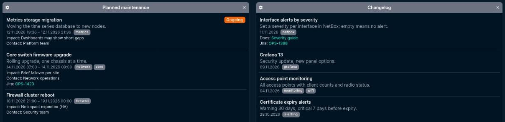
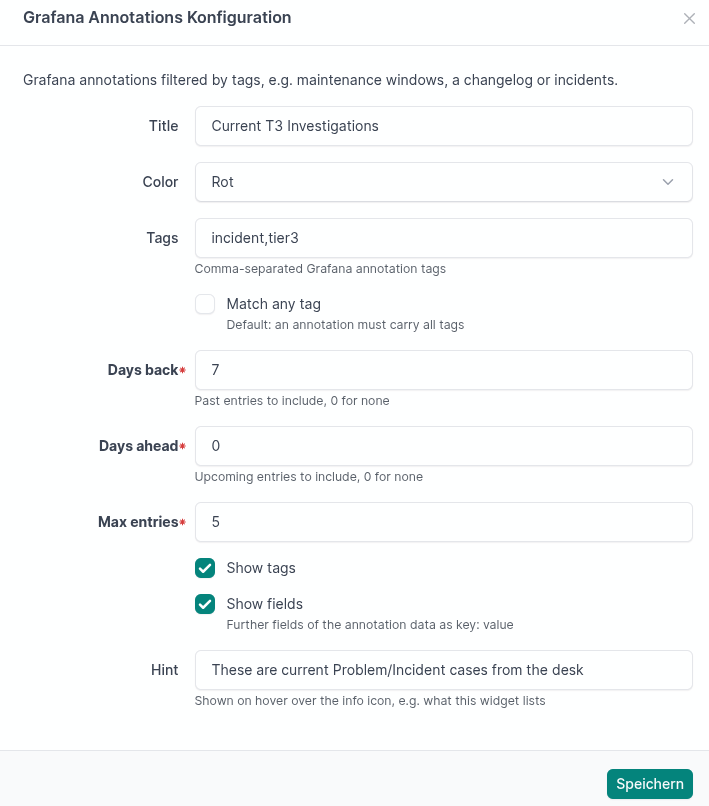

# netbox-grafana-annotations

A NetBox dashboard widget that lists Grafana annotations filtered by tags: upcoming maintenance windows, a changelog, deployments, incidents.



NetBox fetches the annotations server-side (the Grafana token never reaches the browser) and caches them briefly. Each widget has its own tags and time window, so a dashboard can show upcoming maintenance next to a changelog and current incidents.

## Install

```sh
pip install git+https://github.com/zebbra/netbox-grafana-annotations.git@v0.3.0
```

```python
PLUGINS = ["netbox_grafana_annotations"]

PLUGINS_CONFIG = {
    "netbox_grafana_annotations": {
        "grafana_url": "http://grafana.monitoring.svc",        # used for API calls
        "grafana_public_url": "https://grafana.example.com",  # used for links, defaults to grafana_url
    },
}
```

| Setting | Default | |
|---|---|---|
| `grafana_url` | – | Grafana base URL for API calls (required) |
| `grafana_public_url` | `grafana_url` | Base URL for links in the widget |
| `token` | – | Grafana service account token |
| `token_env` | `GRAFANA_ANNOTATIONS_TOKEN` | Environment variable read when `token` is not set |
| `timeout` | `5` | Request timeout in seconds |
| `verify_ssl` | `True` | TLS verification for the API call |
| `cache_timeout` | `300` | Cache lifetime in seconds, `0` disables caching |

Proxies follow NetBox's `HTTP_PROXIES`.

## Grafana token

Create a service account with role **Viewer** and a token for it. Viewer can read organization annotations; nothing else is needed.

## Widget

Add «Grafana Annotations» on the NetBox dashboard and configure:



- **Tags**: comma-separated; by default an annotation must carry all of them, «Match any tag» relaxes that
- **Days back** / **Days ahead**: time window around now; e.g. 0/14 for upcoming maintenance, 30/0 for a changelog, 1/14 to keep yesterday's window visible. Ongoing entries come first, then upcoming (soonest first), then past (newest first, dimmed when the window also looks ahead)
- **Hint**: optional text shown when hovering the info icon, e.g. what the widget lists
- **Max entries**, **Show tags** (the filter tags themselves are never shown), **Show fields**

## Annotation format

**Created by hand in Grafana** (Ctrl+click on a graph, text and tags), the API returns something like:

```json
{
  "time": 1794812400000,
  "timeEnd": 1794819600000,
  "tags": ["maintenance", "firewall"],
  "dashboardUID": "firewalls",
  "panelId": 2,
  "text": "Firewall cluster reboot\nNo impact expected (HA)",
  "data": {}
}
```

The widget shows the first line as title, linked to the dashboard panel, and the following lines as details. HTML in the text is stripped.

**Written by automation**, an annotation can carry structured fields in `data`, which take precedence:

```json
{
  "time": 1794812400000,
  "timeEnd": 1794819600000,
  "tags": ["maintenance", "aci"],
  "text": "<b>ACI exporter deployment</b><br>…",
  "data": {
    "title": "ACI exporter deployment",
    "summary": "New exporter image with APIC fault metrics",
    "url": "https://grafana.example.com/d/maintenance/maintenance",
    "impact": "Short gaps in ACI metrics",
    "contact": "Jane Doe",
    "jira": ["[OPS-123](https://jira.example.com/browse/OPS-123)"],
    "runbook": "https://wiki.example.com/runbook/aci"
  }
}
```

`title` is the linked title (`url`), `summary` a grey line below it. Every further field with a plain value or a list of plain values is listed as `Key: value` (`impact` and `contact` first, nested objects skipped), unless «Show fields» is off. Markdown links (`[text](url)`) and bare URLs in values become links; relative ones are resolved against `grafana_public_url`. Only `http(s)` URLs are rendered as links.

`text` stays what Grafana shows in its own tooltips. Writing `data` needs the HTTP API (`POST /api/annotations`), the Grafana UI only sets text and tags.

## Demo

`dev/` runs NetBox with the plugin from this checkout and a mock Grafana with demo data relative to now (yesterday's, an ongoing and tomorrow's maintenance, a changelog, two incidents):

```sh
cd dev && docker compose up -d
```

After a minute or two, http://localhost:8000 (login `admin` / `admin`) shows four example widgets. `NETBOX_PORT=8080 docker compose up -d` for another port, `docker compose down -v` to clean up. Plugin code changes: `docker compose restart netbox`.

## Development

```sh
PYTHONPATH=. uvx pytest tests
```

## License

MIT
